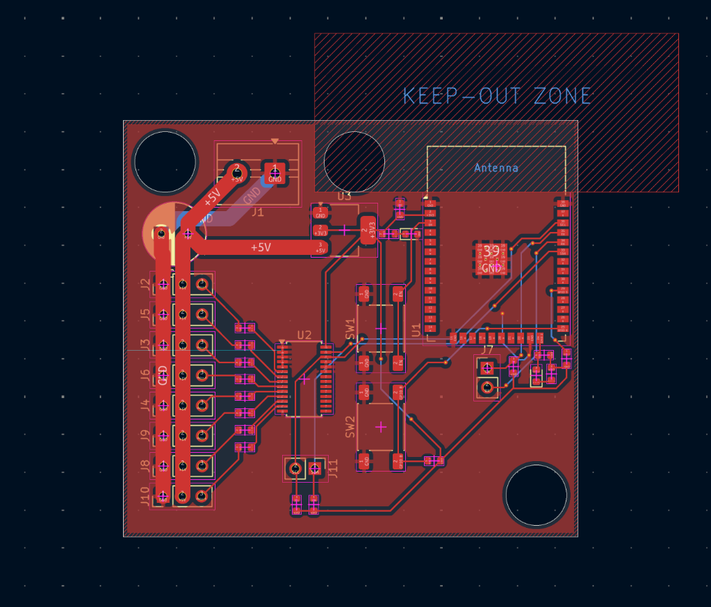
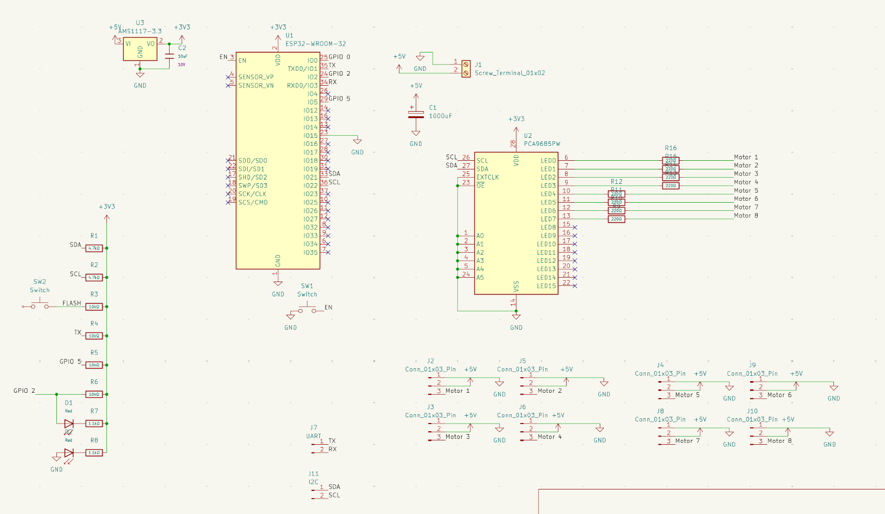

# Robotic Arm

This is the github repo for the Robotic Arm Project in Hack Club's Fallen 2026.

# Hardware

We have decided to make seperate pcbs for the different parts of the robotic arm to increaase modularity and speed up development. the modules are connected either through a uart line or the ESP-NOW protocol.

PCB for the main arm

Schematic for the main arm

schematic for the camera

# Team Members

<ul>
    <li>
        Gordon Peng
    </li>
    <li>
        Manvith
    </li>
    <li>
        Sarthak Vishwakarma
    </li>
</ul>
